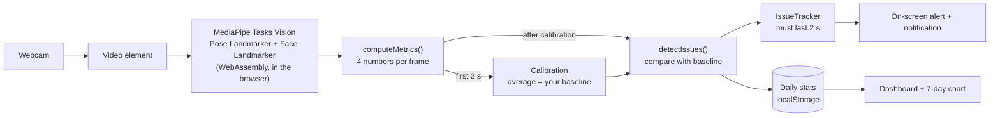

# PostureX

Real-time posture coaching from your webcam. PostureX learns what your good posture looks like, then warns you when you lean forward, sink into your chair, tilt your shoulders or get too close to the screen.

Pose detection runs **entirely in your browser** with MediaPipe. Video never leaves your device.

**[▶ Try the live demo](https://elitevanor.github.io/Posture-X/)** (Chrome, Edge or Firefox on a laptop with a webcam)

<!-- Demo GIF: save it as docs/demo.gif and uncomment the line below.

-->

[](https://github.com/EliteVanor/Posture-X/actions/workflows/ci.yml)

---

## Why

People who work at a desk often slouch for hours without noticing. Ergonomic chairs and wearable posture correctors cost money and need setup. Almost every laptop already has a webcam, so PostureX uses that instead.

## Features

- **Live monitoring** with a skeleton overlay, up to 10 checks per second.
- **Personal calibration.** PostureX records 2 seconds of your good posture and compares each pose with that baseline, not with a generic "ideal" pose.
- **4 posture checks:** head forward, uneven shoulders, sinking back and too close to the screen.
- **No false alarms from one noisy frame.** An issue must last 2 seconds before PostureX shows it.
- **Background alerts.** You get a browser notification when bad posture lasts while you work in another tab. The cooldown is 30 seconds, and you can turn alerts off in Settings.
- **Daily stats and a 7-day chart**, stored only in your browser.
- **Guided setup** that saves your good posture first, then shows what PostureX detects when you slouch.

## How it works



1. The webcam feeds a `<video>` element. MediaPipe's Pose Landmarker and Face Landmarker run on each frame, in WebAssembly, on your machine.
2. `computeMetrics()` turns the landmarks into 4 numbers (see the table below).
3. For the first 2 seconds, PostureX averages these numbers into your **baseline**.
4. After that, `detectIssues()` compares each frame with the baseline.
5. `IssueTracker` passes an issue to the UI only when it lasts 2 seconds.
6. Every tracked second goes into today's stats in `localStorage`. The dashboard reads them back.

### The 4 checks

All coordinates are MediaPipe's normalized image coordinates (0 to 1).

| Issue | Metric | Flagged when |
|---|---|---|
| Head forward | Mean of the angles ear → shoulder → nose (left and right side) | It changes more than **5°** from the baseline |
| Uneven shoulders | Vertical gap between the two shoulders | It changes more than **0.04** from the baseline |
| Sinking back | Vertical position of the nose | It is more than **1.2×** the baseline |
| Too close | Distance between the outer eye corners (Face Landmarker points 33 and 263) | It is more than **1.6×** the baseline |

The thresholds are in one place: `THRESHOLDS` in [`js/posture-core.js`](js/posture-core.js). They match the original Python version in [`backend/posture.py`](backend/posture.py).

### Design decisions

- **In-browser inference, not a server.** The hackathon version sent one JPEG per second to a Flask server. Running MediaPipe in the browser removes the network round trip, raises the check rate from 1 to up to 10 per second, keeps video private, and lets the demo run as a free static site.
- **Calibration against yourself.** Bodies, chairs and camera angles differ a lot, so a fixed "correct" pose would misfire. Every check compares you with your own baseline.
- **Pure logic, separate from the browser.** `js/posture-core.js` has no DOM or MediaPipe code, so Node unit tests cover every check, the calibration math and the alert timing.
- **Missing landmarks never crash detection.** If your face is not visible during calibration, only the "too close" check is skipped. The original version crashed in that case.

## Project structure

```
index.html            Dashboard: live monitor, today's stats, 7-day chart
setup.html, setup/    Guided setup (framing, how to sit, calibrate, test a slouch)
settings.html         Alert settings and "delete my data"
login.html, register.html   Account pages (need the optional backend)
js/
  posture-core.js     Pure posture logic: metrics, checks, calibration, alert timing, stats
  detector.js         MediaPipe Tasks Vision wrapper (pose + face, GPU with CPU fallback)
  monitor.js          Camera loop and states: loading → calibrating → monitoring
  dashboard.js        Dashboard UI, stats and notifications
  setup.js            Setup page UI
  storage.js          localStorage / sessionStorage helpers
  ui.js, auth.js      Shared UI helpers, account forms
css/monitor.css       Monitor, cards and mobile layout
tests/                Unit tests (Node test runner)
backend/              Optional Flask API (original server-side version)
```

## Run it locally

You need Python 3 (for a static file server) and a webcam. The camera only works on `localhost` or HTTPS, so open the page through the server, not as a file.

```bash
git clone https://github.com/EliteVanor/Posture-X.git
```

```bash
cd Posture-X
```

```bash
python3 -m http.server 8000
```

Then open http://localhost:8000.

### Run the tests

The tests need Node 22 and no packages.

```bash
npm test
```

### Optional: the Flask backend

`backend/` holds the original hackathon API: user accounts and server-side posture detection with OpenCV and MediaPipe for Python. The live demo does not need it. The register page uses it when it runs on `http://127.0.0.1:5000`.

```bash
cd backend
```

```bash
pip install -r requirements.txt
```

```bash
python app.py
```

## Status and roadmap

| Version | What changed |
|---|---|
| **v0**: hackathon (March 2025) | Team build in about 24 hours: Flask + OpenCV/MediaPipe backend, HTML/JS frontend, frames sent to the server once per second |
| **v1**: live demo (this version) | Detection moved into the browser, calibration averaged over 2 s, 2-second alert hold, real daily stats and 7-day chart, guided setup that works, unit tests, CI, GitHub Pages deploy |
| **v2**: planned | Fix the backend (per-user calibration, missing-record crashes), store accounts and stats in a database, sync stats from the browser |
| **v3**: planned | Measure accuracy: record labeled sitting clips, report precision and recall for the threshold rules, and compare them with a small classifier trained on the landmarks |

Known limits today:

- The thresholds come from the hackathon and have not been tested on a labeled dataset yet. v3 measures them.
- The checks assume a front-facing camera at roughly eye level.
- Accounts are a placeholder. Login does not check a password, and the backend keeps data in memory.

## Team and credits

PostureX started as a 24-hour hackathon project in March 2025. The original repository is [ryanraen/productx-2025](https://github.com/ryanraen/productx-2025), and the full commit history is kept here.

| Person | v0 hackathon role |
|---|---|
| **Khoi Bui** | Frontend: camera capture, monitoring flow, frontend–API integration. Also worked on the backend API. |
| Apisan | Frontend: dashboard and setup pages, styling |
| Anthony Lu | Backend: Flask API endpoints |
| [Ryan Xie](https://github.com/ryanraen) | Backend: posture detection with OpenCV and MediaPipe |

**v1 rebuild (in-browser detection, tests, CI, deploy) by Khoi Bui.**

Built with [MediaPipe Tasks Vision](https://ai.google.dev/edge/mediapipe/solutions/vision/pose_landmarker) and [Chart.js](https://www.chartjs.org/).
